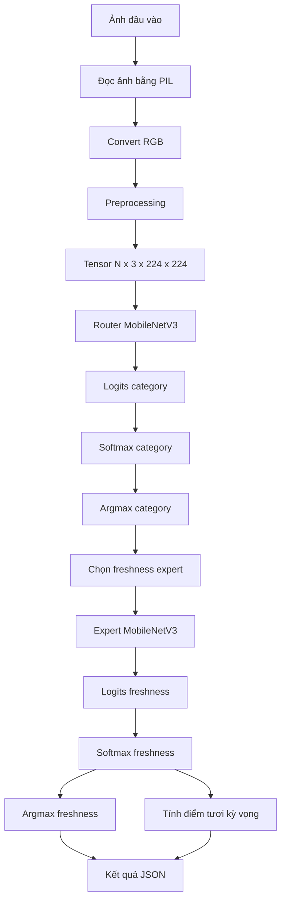
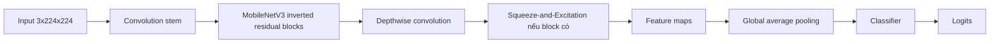

# Thuật toán hoạt động của model

Tài liệu này mô tả đúng pipeline hiện tại, không giả định các cải tiến chưa được triển khai.

## 1. Bài toán

Model nhận một ảnh thực phẩm và trả về hai loại thông tin:

1. Nhóm thực phẩm: `cu`, `gia_cam`, `gia_suc`, `qua`, `rau`.
2. Mức độ tươi trong expert tương ứng.

Pipeline không phải một model duy nhất dự đoán đồng thời cả hai kết quả. Nó gồm:

```text
router classifier + freshness expert classifier
```

## 2. Sơ đồ thuật toán tổng thể



## 3. Tiền xử lý ảnh

### 3.1. Input

Ảnh được mở từ đường dẫn bằng PIL và chuyển sang RGB. Việc chuyển RGB giúp mọi
ảnh có cùng số kênh đầu vào, kể cả ảnh grayscale hoặc ảnh có alpha channel.

### 3.2. Preprocessing khi train

Train transform trong `food_ai.data.build_transforms()` là:

```text
RandomResizedCrop(224, scale=(0.8, 1.0))
RandomHorizontalFlip()
RandomRotation(12 độ)
ToTensor()
Normalize(ImageNet)
```

Random augmentation chỉ chạy trên nhánh train. Mục đích là làm model nhìn thấy
các biến thể vị trí, tỷ lệ và hướng của ảnh, giảm phụ thuộc vào một bố cục cố
định.

### 3.3. Preprocessing khi validation, test và inference

Các nhánh đánh giá và dự đoán dùng transform xác định:

```text
Resize(232)
CenterCrop(224)
ToTensor()
Normalize(ImageNet)
```

ImageNet normalization:

```text
mean = (0.485, 0.456, 0.406)
std  = (0.229, 0.224, 0.225)
```

Với mỗi kênh màu và pixel tensor $x$, phép chuẩn hóa là:

$$
 x' = \frac{x - mean}{std}
$$

Tensor sau cùng có:

```text
shape = N x 3 x 224 x 224
dtype = float32
```

`N` là batch size. Khi dự đoán một ảnh, `N = 1`.

### 3.4. Vì sao không resize thẳng về 224

Pipeline chuẩn resize cạnh ngắn lên `232`, sau đó crop giữa vùng `224x224`. Cách
này giữ tỷ lệ ảnh tốt hơn resize cưỡng bức cả chiều rộng và chiều cao về cùng
`224`, vốn có thể làm biến dạng thực phẩm. PyTorch, ONNX Python inference và
validation hiện dùng cùng quy trình này.

## 4. Kiến trúc MobileNetV3

Mỗi router/expert được tạo bởi `food_ai.model.create_model()`:



Model được khởi tạo từ pretrained ImageNet khi train. Classifier cuối được thay
bằng một lớp tuyến tính có số output bằng số class của task:

```text
router: 5 output hiện tại
expert 2-class: 2 output
expert 3-class: 3 output
```

Các kiến trúc được code hỗ trợ:

```text
mobilenet_v3_large
mobilenet_v3_small
efficientnet_b0
resnet18
```

MobileNetV3-Large là mặc định hiện tại. Tên model thực tế phải lấy từ checkpoint;
không nên suy luận chỉ từ tên file.

## 5. Forward pass và logits

Với tensor ảnh $x$, model thực hiện forward:

$$
 z = f_\theta(x)
$$

Trong đó:

- $f_\theta$ là CNN với trọng số $\theta$.
- $z$ là vector logits, chưa phải xác suất.
- Số phần tử của $z$ bằng số class của checkpoint.

Khi train, logits được đưa trực tiếp vào `CrossEntropyLoss`; không gọi softmax
trước loss.

Khi inference, code chuyển logits thành xác suất bằng softmax:

$$
 p_i = \frac{e^{z_i}}{\sum_j e^{z_j}}
$$

Class dự đoán là:

$$
 \hat{y} = \arg\max_i(p_i)
$$

Confidence hiện tại là $p_{\hat{y}}$. Đây là softmax confidence, chưa được
calibration nên không mặc nhiên là xác suất model đúng.

## 6. Thuật toán router

Router được train trên các thư mục category ở tầng `data/train` và được lưu tại
`models/router.pth` hoặc export thành `models/router.onnx`.

Khi inference:

1. Nhận tensor ảnh đã preprocessing.
2. Chạy router MobileNetV3.
3. Tính softmax trên 5 category.
4. Chọn category có xác suất lớn nhất.
5. Tạo đường dẫn đến expert category đó.
6. Chạy đúng một freshness expert.

Mapping hiện tại:

```text
cu       -> models/freshness/cu.pth hoặc cu.onnx
gia_cam  -> models/freshness/gia_cam.pth hoặc gia_cam.onnx
gia_suc  -> models/freshness/gia_suc.pth hoặc gia_suc.onnx
qua      -> models/freshness/qua.pth hoặc qua.onnx
rau      -> models/freshness/rau.pth hoặc rau.onnx
```

Router chỉ chọn một expert bằng argmax. Chưa có top-k routing, threshold reject,
`UNKNOWN` hoặc fallback sang expert khác.

## 7. Thuật toán freshness expert

Expert nhận lại **toàn bộ tensor ảnh**, không nhận feature trung gian từ router.
Mỗi expert chỉ được train trên category của nó.

Class thực tế của checkpoint hiện tại:

| Expert | Classes |
|---|---|
| `cu` | `FRESH`, `SPOILED` |
| `gia_cam` | `FRESH`, `HALF-FRESH`, `SPOILED` |
| `gia_suc` | `FRESH`, `HALF-FRESH`, `SPOILED` |
| `qua` | `FRESH`, `SPOILED` |
| `rau` | `FRESH`, `SPOILED` |

Expert không được ép thành 3 class nếu checkpoint chỉ có 2 class. Class order
phải đọc từ `checkpoint["classes"]` hoặc manifest.

## 8. Tính điểm tươi

Sau khi expert tạo xác suất, code lấy điểm kỳ vọng theo anchor:

$$
 S = \sum_{c \in C} p(c \mid x) \times a(c)
$$

Với anchor hiện tại:

```text
FRESH      -> 10.0
HALF-FRESH ->  5.5
SPOILED    ->  1.0
```

Ví dụ expert 3 lớp:

```text
score = p(FRESH) * 10.0
      + p(HALF-FRESH) * 5.5
      + p(SPOILED) * 1.0
```

Expert 2 lớp chỉ có hai thành phần thực tế:

```text
score = p(FRESH) * 10.0
      + p(SPOILED) * 1.0
```

Điểm này là kỳ vọng toán học trên xác suất model, không phải phép đo vật lý về
độ tươi và không phải chứng nhận an toàn thực phẩm.

## 9. Thuật toán huấn luyện

### 9.1. Chuẩn bị dữ liệu

- `ImageFolder` đọc class từ tên thư mục.
- `data/train` được chia ngẫu nhiên 80/20 bằng seed `42` để tạo train và test nội bộ.
- `data/valid` được dùng riêng cho validation, chọn checkpoint và early stopping.
- Hiện tại việc chia là theo file, chưa phải group split theo source/product/session/object.

### 9.2. Cập nhật trọng số

Mỗi batch thực hiện:

```text
images
  -> forward
  -> logits
  -> CrossEntropyLoss(label_smoothing=0.05)
  -> backward/autograd
  -> optimizer.step()
```

Optimizer mặc định là AdamW. Scheduler mặc định là `ReduceLROnPlateau`; cosine
cũng được hỗ trợ. Khi có CUDA, AMP dùng autocast và GradScaler.

### 9.3. Chọn checkpoint

Sau mỗi epoch, code tính train loss/accuracy và validation loss/accuracy. Nếu
validation loss cải thiện:

```text
runs/<run>/best_model.pth được cập nhật
models/<task>.pth được copy từ best model
```

`last_checkpoint.pth` lưu trạng thái mới nhất để resume. Test nội bộ được chấm
sau khi chọn best checkpoint.

## 10. Đánh giá đơn và đánh giá đa

### Đánh giá đơn

Đánh giá một model độc lập:

```text
một ảnh -> một router hoặc một expert -> một class
```

Dùng để đo chất lượng riêng của router hoặc expert khi category đã biết. Metric
nên gồm accuracy, macro-F1, recall `SPOILED` và confusion matrix.

### Đánh giá đa tầng

Đánh giá pipeline thật:

```text
một ảnh
  -> router dự đoán category
  -> category quyết định expert
  -> expert dự đoán freshness
```

Metric phải tách thành:

- Router accuracy.
- Expert accuracy với category đúng (oracle).
- End-to-end accuracy khi router tự chọn expert.
- Tỷ lệ router chọn sai expert.
- Macro-F1 và recall `SPOILED` ở kết quả cuối.

## 11. Giới hạn diễn giải

Dataset hiện đã có exact duplicate giữa train và valid, đồng thời có nguy cơ
cùng source/product xuất hiện ở nhiều split. Vì vậy:

- Accuracy và confidence hiện tại có thể lạc quan.
- Augmentation không loại bỏ leakage.
- Pretrained ImageNet không ngăn model học vẹt.
- Cần group split, SHA-256, perceptual hash/embedding và test độc lập trước khi
  kết luận khả năng tổng quát hóa.

Các file triển khai liên quan:

```text
food_ai/data.py       -> transforms và DataLoader
food_ai/model.py      -> tạo MobileNetV3 và load checkpoint
predict.py            -> PyTorch router + expert inference
inference.py          -> ONNX router + expert inference
train.py              -> huấn luyện và checkpoint
export_onnx.py        -> export ONNX
```
