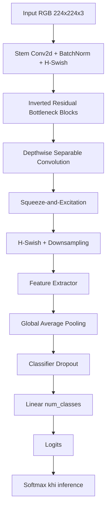
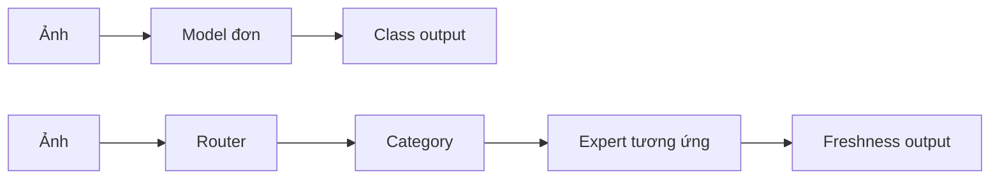

# Phương pháp so sánh model

Tài liệu này định nghĩa cách so sánh model cũ, model hiện tại và các biến thể
MobileNetV3 mà không nhầm giữa chất lượng model với chất lượng split dữ liệu.

## 1. Các model cần so sánh

| Nhóm | Artifact | Vai trò | Metadata hiện có |
|---|---|---|---|
| Legacy | `models/legacy_mobilenetv3_food.pth` | baseline cũ | Chỉ là state dict, không có `classes`, `task`, `model_name` |
| Router hiện tại | `models/router.pth` | 5-category classifier | MobileNetV3-Large, `classes` đầy đủ |
| Expert hiện tại | `models/freshness/*.pth` | freshness theo category | Một số checkpoint có metadata đầy đủ, một số là checkpoint cũ |
| ONNX hiện tại | `models/router.onnx`, `models/freshness/*.onnx` | triển khai client | Logits; có thể kèm `.onnx.data` |

Legacy model không thể so sánh công bằng ngay với router hiện tại nếu chưa biết
số lớp, thứ tự lớp, preprocessing và dataset mà nó đã học. Vì vậy legacy chỉ
được gọi là baseline sau khi khôi phục đủ metadata.

## 2. Sơ đồ lớp CNN

Một classifier MobileNetV3 trong dự án có cấu trúc khái quát:



Đây là sơ đồ logic, không phải danh sách từng tensor của một checkpoint cụ thể.
`mobilenet_v3_small` và `mobilenet_v3_large` cùng họ kiến trúc nhưng khác số
block/channel nên phải ghi model name trong kết quả benchmark.

### Phân biệt classifier đơn và pipeline đa tầng



## 3. Đánh giá đơn (single-model evaluation)

Đánh giá đơn hỏi: **một model riêng lẻ có phân loại đúng task của nó không?**

### Router đơn

- Input: ảnh từ `data/valid` hoặc test độc lập.
- Target: category.
- Model: `models/router.pth` hoặc một baseline router.
- Metrics: accuracy, macro-F1, precision/recall/F1 từng category, confusion matrix.

### Expert đơn

Đánh giá từng expert riêng, với category đã biết trước:

- Input: ảnh trong `data/valid/<category>`.
- Target: freshness class thực tế của expert đó.
- Metrics: accuracy, macro-F1, recall `SPOILED`, confusion matrix.
- Không ép expert 2 lớp thành 3 lớp; class list phải lấy từ checkpoint.

`freshness_oracle_category` trong evaluator là cách đo gần với expert đơn,
vì category đúng được cung cấp trước khi gọi expert.

## 4. Đánh giá đa (multi-stage/end-to-end evaluation)

Đánh giá đa hỏi: **toàn bộ hệ thống có trả đúng kết quả khi category chưa biết
và router phải chọn expert không?**

Luồng đo:

```text
ảnh -> router prediction -> expert được chọn -> freshness prediction
```

Cần báo cáo riêng:

1. Router accuracy.
2. Expert oracle accuracy khi biết category đúng.
3. End-to-end freshness accuracy khi router tự chọn expert.
4. Tỷ lệ router chọn sai expert.
5. Macro-F1 và recall `SPOILED` của kết quả cuối.
6. Coverage/accepted accuracy nếu bật threshold uncertainty.

Một lỗi router có thể làm freshness sai dù expert đúng khi được gọi riêng. Vì
vậy không dùng expert accuracy đơn để đại diện cho chất lượng pipeline đa tầng.

## 5. Phương pháp so sánh công bằng

Mỗi model phải được đánh giá trên cùng:

- Dataset version.
- Group split và seed.
- Preprocessing.
- Danh sách class và thứ tự class.
- Batch size/evaluation batch policy.
- Thiết bị hoặc ghi rõ CPU/GPU.
- Số lượng ảnh và phân bố class.

Dataset hiện tại có cross-split duplicate giữa train và valid, nên cần tạo split
sạch trước khi dùng kết quả để chọn model. Test độc lập nên đến từ source,
product/object hoặc session chưa xuất hiện trong train.

### Bảng kết quả đề xuất

| Model | Task | Classes | Split | Accuracy | Macro-F1 | Recall SPOILED | Latency/image | Size |
|---|---|---:|---|---:|---:|---:|---:|---:|
| Legacy | ... | ... | clean test | ... | ... | ... | ... | ... |
| MobileNetV3-Small | router/expert | ... | clean test | ... | ... | ... | ... | ... |
| MobileNetV3-Large | router/expert | ... | clean test | ... | ... | ... | ... | ... |

Không xếp hạng model chỉ theo accuracy. Với freshness, recall `SPOILED` và
hiệu năng trên source mới quan trọng hơn điểm tổng thể.

## 6. Lệnh và công cụ hiện có

```powershell
python evaluate_end_to_end.py --root data\valid
python evaluate_router_uncertainty.py --root data\valid --threshold 0.8
python benchmark_mobilenet.py router --epochs 15 --workers 0
python benchmark_mobilenet.py freshness --category gia_cam --epochs 15 --workers 0
python verify_onnx.py --image path\to\image.jpg
```

Lưu ý: evaluator end-to-end hiện yêu cầu class list freshness giống nhau giữa
các expert, trong khi artifact hiện tại trộn expert 2 lớp và 3 lớp. Cần sửa
contract/evaluator trước khi coi kết quả multi-stage là hợp lệ.

## 7. Tiêu chí chọn model phát hành

Chỉ chọn model sau khi:

- Không còn exact/near-duplicate giữa các split.
- Có test độc lập theo group/source.
- Có kết quả single và multi-stage.
- Có recall `SPOILED` đạt ngưỡng nghiệp vụ.
- PyTorch và ONNX cho kết quả tương đương.
- Class order, preprocessing, checksum và model version nằm trong manifest.
- Độ trễ và kích thước phù hợp thiết bị đích.
