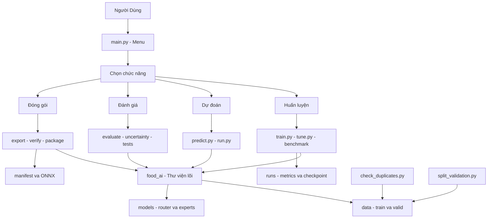

# Chức năng các file trong dự án

Tài liệu này mô tả vai trò của các file hiện đang có trong project `vnecheck`.
Pipeline model chính là:

```text
ảnh
  -> router phân loại category
  -> chọn freshness expert
  -> dự đoán freshness
  -> tính điểm tươi ước tính
```

## 1. Sơ đồ cấu trúc thư mục

```text
vnecheck/
├── README.md                         # Giới thiệu và lệnh nhanh
├── ARCHITECTURE.md                   # Kiến trúc router + expert
├── ALGORITHM.md                      # Thuật toán và preprocessing
├── DATA.md                           # Dataset và kiểm soát leakage
├── TRAIN.md                          # Hướng dẫn train/vận hành
├── LIBRARY_PRINCIPLES.md             # Nguyên lý PyTorch/metric
├── MODEL_COMPARISON.md               # Phương pháp so sánh model
├── PROJECT_FILES.md                  # Tài liệu file này
├── requirements.txt                  # Python dependencies
├── .gitignore                        # File/thư mục không đưa vào Git
│
├── main.py                           # Menu tương tác chính
├── run.py                            # Shortcut gọi predict.py
├── train.py                          # Huấn luyện router/expert
├── predict.py                        # Inference PyTorch chính
├── inference.py                      # Inference ONNX
├── export_onnx.py                    # Export checkpoint sang ONNX
├── verify_onnx.py                    # So sánh PyTorch và ONNX
│
├── tune.py                           # Grid search model/hyperparameter
├── benchmark_mobilenet.py            # Benchmark các biến thể MobileNetV3
├── evaluate_end_to_end.py            # Đánh giá router -> expert
├── evaluate_router_uncertainty.py    # Đánh giá confidence/entropy router
│
├── split_validation.py               # Tách dữ liệu validation hiện tại
├── package_models.py                 # Manifest/checksum và copy assets
├── test_regression.py                # Regression tests
│
├── food_ai/                          # Thư viện lõi dùng chung
│   ├── __init__.py
│   ├── config.py
│   ├── data.py
│   ├── model.py
│   └── experiment.py
│
├── scripts/
│   └── check_duplicates.py           # Phát hiện ảnh trùng SHA-256
│
├── data/                             # Dataset, đang bị Git ignore
│   ├── train/
│   └── valid/
│
├── models/                           # Checkpoint/ONNX, đang bị Git ignore
│   ├── router.pth
│   ├── router.onnx
│   ├── router.onnx.data              # Có thể cần cho ONNX external data
│   ├── legacy_mobilenetv3_food.pth   # Model legacy
│   └── freshness/
│       ├── cu.pth / cu.onnx
│       ├── gia_cam.pth / gia_cam.onnx
│       ├── gia_suc.pth / gia_suc.onnx
│       ├── qua.pth / qua.onnx
│       └── rau.pth / rau.onnx
│
└── runs/                             # Kết quả từng lần train/benchmark
    └── <run>/
        ├── config.json
        ├── metrics.csv
        ├── best_model.pth
        ├── last_checkpoint.pth
        └── summary.json
```

## 2. Các file chạy chính

### `main.py`

Menu tương tác cho người dùng. File này không chứa logic CNN; nó nhận lựa chọn
rồi gọi các script khác bằng subprocess:

- Train router.
- Train freshness expert.
- Dự đoán ảnh.
- Kiểm tra trạng thái dataset.
- Tuning tham số.
- Xem kết quả các run.

Chạy:

```powershell
python main.py
```

### `train.py`

File huấn luyện chính. Có hai task:

```text
router                         data/train -> category
freshness --category <name>    data/train/<category> -> freshness
```

Nó thực hiện:

1. Đọc tham số command line.
2. Chọn thư mục dataset.
3. Tạo DataLoader từ `food_ai.data`.
4. Tạo model từ `food_ai.model`.
5. Dùng CrossEntropyLoss, optimizer và scheduler.
6. Train, validate và early stopping.
7. Lưu checkpoint tốt nhất và checkpoint mới nhất.
8. Chấm test nội bộ sau khi chọn best checkpoint.

Lệnh mẫu:

```powershell
python train.py router
python train.py freshness --category gia_cam
```

### `predict.py`

Inference PyTorch production hiện tại:

```text
ảnh -> preprocessing -> router.pth -> category -> expert .pth -> JSON
```

File này đọc `classes` từ checkpoint, nên phù hợp hơn các script debug cũ khi
class order thay đổi.

```powershell
python predict.py path\to\image.jpg
```

### `inference.py`

Inference ONNX bằng `onnxruntime`. Nó thực hiện cùng pipeline router -> expert
nhưng đọc artifact `.onnx`:

```text
ảnh -> preprocessing -> router.onnx -> category -> freshness/<category>.onnx
```

Các hàm chính:

- `preprocess()`: chuyển ảnh sang RGB và tạo tensor chuẩn.
- `softmax()`: chuyển logits thành xác suất.
- `run_model()`: chạy ONNX Runtime.
- `main()`: in category, confidence và freshness.

### `run.py`

Wrapper tối giản gọi `predict.main()`. Nó chỉ là shortcut, không có logic model
riêng.

```powershell
python run.py path\to\image.jpg
```

## 3. Thư viện lõi `food_ai/`

### `food_ai/config.py`

Nguồn cấu hình chung:

- `CATEGORIES`: 5 category và thứ tự canonical.
- `CATEGORY_LABELS`: tên hiển thị category.
- `FRESHNESS_CLASSES`: các freshness class chuẩn.
- `FRESHNESS_ANCHORS`: anchor dùng tính điểm tươi.
- `DATA_DIR`, `MODEL_DIR`, `ROUTER_MODEL`.
- `freshness_model(category)`: tạo đường dẫn expert.

Lưu ý: contract cấu hình có 3 freshness class, nhưng checkpoint hiện tại có
expert 2 lớp và 3 lớp. Xem [MODEL_COMPARISON.md](MODEL_COMPARISON.md).

### `food_ai/data.py`

Quản lý dữ liệu và preprocessing:

- `NonEmptyImageFolder`: bỏ qua class directory không có ảnh.
- `build_transforms()`: tạo train transform và eval transform.
- `create_loaders()`: tạo train/validation/test DataLoader.

Preprocessing eval/inference:

```text
RGB -> Resize(232) -> CenterCrop(224) -> ToTensor -> ImageNet normalize
```

Hiện `create_loaders()` vẫn tách test nội bộ ngẫu nhiên theo file, chưa phải
group split theo source/product/session.

### `food_ai/model.py`

Factory và tiện ích model:

- `create_model()`: tạo MobileNetV3-Small/Large, EfficientNet-B0 hoặc ResNet18.
- `classifier_parameters()`: lấy classifier cần train.
- `configure_training_method()`: cấu hình `fine_tune` hoặc `head_only`.
- `trainable_parameters()`: lấy parameter có `requires_grad=True`.
- `load_checkpoint()`: dựng model và nạp `state_dict`.

MobileNetV3-Large là model mặc định. Khi train, model dùng pretrained ImageNet;
khi inference, checkpoint cung cấp trọng số đã train.

### `food_ai/experiment.py`

Quản lý experiment:

- Tạo thư mục run theo timestamp.
- Ghi `config.json`.
- Ghi metrics từng epoch vào `metrics.csv`.
- Ghi `summary.json`.
- Tính accuracy, precision, recall, F1 và confusion matrix.

## 4. Đánh giá, benchmark và chất lượng dữ liệu

### `evaluate_end_to_end.py`

Đánh giá ba góc nhìn:

- Router category.
- Freshness expert khi biết category đúng (oracle).
- Freshness khi router tự chọn expert.

Hiện file yêu cầu các expert có cùng class list, nên chưa chạy được với trạng
thái hiện tại gồm expert 2 lớp và 3 lớp.

### `evaluate_router_uncertainty.py`

Đo độ tin cậy router:

- Mean confidence.
- Entropy.
- Accuracy theo confidence bin.
- Coverage.
- Accepted accuracy theo threshold.

File này chỉ đánh giá uncertainty; chưa bật reject hoặc `UNKNOWN` trong inference.

### `benchmark_mobilenet.py`

Chạy các trial có cùng cấu hình để so sánh:

```text
MobileNetV3-Large + fine_tune
MobileNetV3-Small + fine_tune
MobileNetV3-Small + head_only
```

Kết quả lấy từ `summary.json` và ghi thành leaderboard CSV trong `runs/`.
Không dùng kết quả split đang leakage để chọn model phát hành.

### `tune.py`

Grid search rộng hơn `benchmark_mobilenet.py`, gồm MobileNetV3, EfficientNet-B0,
method và learning rate khác nhau. File này gọi lại `train.py` cho từng trial.

### `split_validation.py`

Di chuyển ảnh từ product folder trong `data/train` sang `data/valid`. Đây là
công cụ dữ liệu hiện tại, nhưng chưa bảo đảm loại bỏ group/source leakage.
Không chạy nếu chưa có backup và chưa xác định quy tắc chia dữ liệu.

### `scripts/check_duplicates.py`

Quét SHA-256 ảnh giữa train và valid:

```powershell
python scripts\check_duplicates.py
```

Exit code `1` nghĩa là đã phát hiện ảnh trùng byte giữa các split. Công cụ không
phát hiện được mọi near-duplicate sau resize/crop/nén.

## 5. Export, đóng gói và test

### `export_onnx.py`

Đọc checkpoint PyTorch và export thành ONNX với:

```text
Input: N x 3 x 224 x 224 float32
Output: logits
Batch: dynamic
```

Chạy:

```powershell
python export_onnx.py
```

### `verify_onnx.py`

Chạy cùng tensor qua PyTorch và ONNX, sau đó so sánh probability/top-1. Ngưỡng
sai khác hiện tại là `1e-5`.

```powershell
python verify_onnx.py --image path\to\image.jpg
```

### `package_models.py`

Tạo `models/manifest.json`, ghi:

- model name.
- training method.
- class order.
- preprocessing contract.
- checksum SHA-256 của checkpoint/ONNX.
- checksum file `.onnx.data` nếu có.

Có thể copy model sang Flutter bằng `--assets-destination`.

### `test_regression.py`

Các test nhỏ cho:

- Category/freshness order.
- Duplicate detector.
- Preprocessing shape/dtype.
- Manifest contract nếu manifest tồn tại.

Chạy:

```powershell
python -m unittest -v test_regression.py
```

## 6. Artifact và tài liệu

### `models/`

Model runtime:

- `router.pth`: router PyTorch.
- `router.onnx`: router ONNX.
- `freshness/<category>.pth`: expert PyTorch.
- `freshness/<category>.onnx`: expert ONNX.
- `.onnx.data`: external data nếu ONNX cần.
- `legacy_mobilenetv3_food.pth`: artifact cũ, không thuộc pipeline chính.

### `runs/`

Mỗi lần train tạo một run riêng. `best_model.pth` dùng cho model tốt nhất theo
validation loss; `last_checkpoint.pth` dùng resume. `metrics.csv` và
`summary.json` dùng phân tích kết quả.

### `requirements.txt`

Danh sách dependency chính:

```text
torch
torchvision
Pillow
opencv-python
numpy
onnx
onnxscript
```

### Các file Markdown

- `README.md`: bắt đầu nhanh và trạng thái tổng quan.
- `ARCHITECTURE.md`: thiết kế router/expert.
- `ALGORITHM.md`: thuật toán, preprocessing và công thức.
- `DATA.md`: dataset, duplicate và split sạch.
- `TRAIN.md`: hướng dẫn train/vận hành.
- `LIBRARY_PRINCIPLES.md`: nguyên lý framework và metric.
- `MODEL_COMPARISON.md`: so sánh model đơn/đa tầng.
- `PROJECT_FILES.md`: bản đồ file và chức năng.

## 7. Sơ đồ quan hệ file



## 8. File nào cần dùng trong từng việc

| Việc cần làm | File chính |
|---|---|
| Train router | `train.py router` |
| Train freshness expert | `train.py freshness --category ...` |
| Dự đoán PyTorch | `predict.py` |
| Dự đoán ONNX | `inference.py` |
| Đánh giá router | `evaluate_router_uncertainty.py` |
| Đánh giá router + expert | `evaluate_end_to_end.py` |
| Kiểm tra duplicate | `scripts/check_duplicates.py` |
| So sánh MobileNetV3 | `benchmark_mobilenet.py` |
| Tuning | `tune.py` |
| Export ONNX | `export_onnx.py` |
| Verify ONNX | `verify_onnx.py` |
| Đóng gói model | `package_models.py` |
| Chạy test | `test_regression.py` |
| Menu người dùng | `main.py` |

Các script debug cũ `check.py`, `check_classes.py`, `check_onnx.py`,
`check_router.py`, `compare_pth_onnx.py` và `evaluate_router.py` đã được xóa vì
không thuộc pipeline hiện tại.
